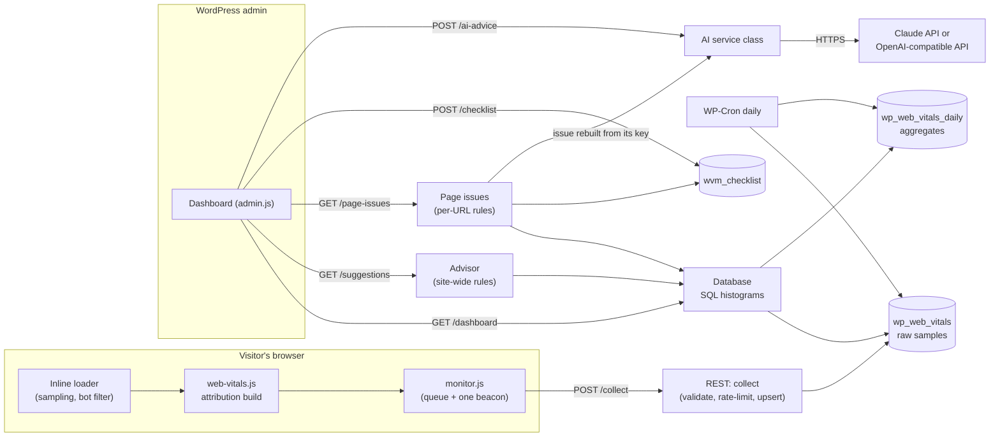
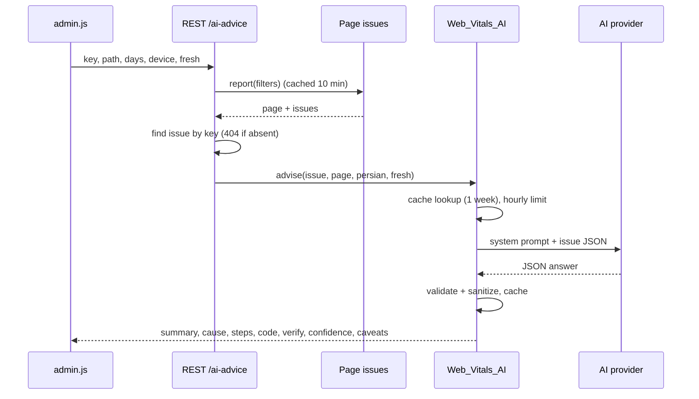

# Architecture

This document describes how Real User Web Vitals Monitor 1.4.0 is built: its components, how requests flow through them, the data model, and the reasons behind the main design decisions. For installation, settings and usage, see [README.md](README.md).

## 1. Overview

The plugin has three parts:

1. **Collection**: a tiny inline loader and a vanilla collector measure Core Web Vitals in visitors' browsers and send them to a public REST endpoint, which stores them in a custom table.
2. **Analysis**: admin endpoints turn raw samples into P75 statistics, site-wide suggestions, and per-page issue checklists, using fixed rules.
3. **Assistance** (optional): an administrator can ask an AI model about one checklist issue.

## 2. Components

All PHP classes are `final`, built once in `Web_Vitals_Monitor` (the bootstrap in `web-vitals-monitor.php`) and wired by constructor injection. There is no autoloader or build step.

| Class / file | Responsibility | Depends on |
|---|---|---|
| `Web_Vitals_Monitor` (`web-vitals-monitor.php`) | Bootstrap, activation, text domain, schema upgrade with a lock | all services |
| `Web_Vitals_Config` | Metric list, thresholds, defaults, settings sanitizer, bot pattern, glob-to-regex | none |
| `Web_Vitals_Settings` | Settings API registration (`wvm_settings`, `wvm_ai`), per-request cache, suggestions-language switching | Config, AI |
| `Web_Vitals_Collector` | Decides per page whether to measure; prints config + inline loader in `wp_footer`; detects page type | Settings |
| `Web_Vitals_REST_API` | All REST routes, payload validation, bot filter, rate limiting, report caching | Database, Settings, Advisor, Page issues, AI |
| `Web_Vitals_Database` | Schema and migration, upserts, histogram percentiles, trends, top URLs, segments, attribution samples, aggregation, cleanup, export | Config |
| `Web_Vitals_Advisor` | Site-wide suggestions from slow samples; script ownership | Database, Settings |
| `Web_Vitals_Page_Issues` | Per-URL issue detection, fix text, code snippets, checklist state and verification | Database, Advisor |
| `Web_Vitals_AI` | AI settings and key encryption, prompt building, provider calls, answer validation, caching, limits | none (WordPress HTTP API) |
| `Web_Vitals_Cron` | Daily aggregation and retention cleanup | Database, Settings |
| `Web_Vitals_Admin` | Menu, asset loading, localized strings, export, delete, AI connection test | Database, Settings, AI |
| `assets/js/monitor.js` | Frontend collector | `web-vitals.js` |
| `assets/js/admin.js` | Dashboard rendering (DOM APIs only, SVG charts) | REST API |
| `assets/css/tokens.css`, `admin.css`, `fonts.css` | Design tokens, design-system components plus the plugin layer (dashboard grid, settings page, WordPress admin overrides), self-hosted font faces | `assets/fonts/` |
| `languages/*-fa_IR.po/.mo` | Persian strings of the suggestions, checklist and AI sections | none |

Extension points: the `wvm_should_collect` filter (skip measurement on a page) and the `wvm_client_ip` filter (client IP for rate limiting).

## 3. Request lifecycles

### 3.1 Frontend page render

`Web_Vitals_Collector::print_loader()` runs in `wp_footer` (priority 99). It returns early for admin, feeds, robots, previews, the customizer, a sampling rate of 0, excluded administrators or logged-in users, excluded URL patterns, or when `wvm_should_collect` returns false. Otherwise it prints one inline script (via `wp_print_inline_script_tag`, so CSP nonce filters apply) with:

- `window.wvmConfig`: endpoint, sampling rate, delay, load strategy, bot regex, excluded user-agent regex, script URLs, page path and type, enabled metrics, attribution flag;
- the loader (~600 bytes).

Settings are autoloaded, so this adds no database query. The decisions here depend only on the URL and the logged-in user, which page caches already vary by; per-visitor decisions are left to the browser.

### 3.2 In the browser

1. The loader returns immediately for `navigator.webdriver`, unsampled visits, bots and excluded user agents.
2. Otherwise it injects `web-vitals.js` and `monitor.js` (`async = false` keeps their order): by default after `load` + `requestIdleCallback`, or right away with the "early" strategy.
3. `monitor.js` registers `onLCP`, `onINP`, `onCLS`, `onFCP`, `onTTFB` for the enabled metrics. `web-vitals` reads buffered performance entries, so loading late does not lose LCP, FCP, TTFB or CLS.
4. Each report is reduced to compact attribution (see section 5.1) and queued under `name:id`, so a newer report of the same metric instance replaces the older one.
5. On `visibilitychange` (hidden) or `pagehide`, the queue is sent as one request `{"c": context, "m": [metrics]}` with `navigator.sendBeacon`, or `fetch` with `keepalive` as a fallback. The visibility listener is added after the `web-vitals` listeners, so final LCP/CLS/INP values are queued first.

### 3.3 Collection endpoint

`POST /web-vitals/v1/collect` (public):

1. Rejects when monitoring is off, the body exceeds 16 KB, or the user agent is empty, a bot, or excluded (checked again server-side because the browser can be bypassed).
2. Rate-limits per client IP in fixed one-minute windows: `wp_cache_incr` when a persistent object cache exists, otherwise a transient per window. The IP is salted and hashed; with "behind a CDN" enabled, `CF-Connecting-IP` / `X-Real-IP` / `X-Forwarded-For` are used.
3. Merges the shared context into each metric (up to 10), validates name, value range and id, sanitizes path, enums and allow-listed attribution keys (resource URLs lose their query string, the render-blocking list is parsed and rebuilt), and computes the rating from the thresholds.
4. Writes all metrics with one `INSERT ... ON DUPLICATE KEY UPDATE` keyed by `(metric_id, metric_name)`, updating value, rating and attribution.

### 3.4 Dashboard

`admin.js` loads three reports in parallel for the selected range, device and optional URL:

| Request | Built by | Cache |
|---|---|---|
| `GET /dashboard` | `Database::dashboard_data()` | 60 s |
| `GET /suggestions` | `Advisor::analyze()` in the suggestions language | 10 min |
| `GET /page-issues` | `Page_Issues::report()` in the suggestions language | 10 min |

Report caches are transients keyed by `md5(days, device, path, wvm_cache_version, admin locale, suggestions language)`. "Refresh" sends `fresh=1`; auto-refresh reloads only the dashboard data, so open checklists are not collapsed. Deleting all data or ticking an item increments `wvm_cache_version`, invalidating every cached report at once.

### 3.5 Checklist tick and verification

`POST /checklist {key, done}` stores `key => {done: timestamp, by: display name}` in the `wvm_checklist` option (at most 1000 entries, oldest dropped) and bumps the cache version. When the checklist is built, each ticked issue is re-checked by running the same detection on the page's samples newer than the tick (see section 5.4).

### 3.6 AI advice

The browser sends only identifiers. The issue content sent to the model is rebuilt on the server, so a forged request cannot inject arbitrary text into the prompt.

### 3.7 Daily cron

`wvm_cleanup_event` runs daily (scheduled on activation and re-checked on `admin_init`):

1. `aggregate_pending()` aggregates each completed UTC day not yet aggregated (up to 31 per run, starting 90 days back on the first run) into `wp_web_vitals_daily`, for all devices and per device. `wvm_last_aggregated` records progress.
2. `cleanup()` deletes raw rows older than the retention period in batches (`DELETE ... ORDER BY created_at LIMIT n`), repeating until a batch is not full or 20 seconds have passed, then deletes daily rows older than max(2 years, retention).

### 3.8 Schema upgrade

`maybe_upgrade_database()` runs on `admin_init` only, never on frontend requests. It compares `wvm_db_version` with `WVM_DB_VERSION` and takes a lock (`wvm_upgrade_lock`, an option added atomically; taken over after 10 minutes). The v1 → v2 migration is detected by the schema itself (table present, `metric_uid` index absent), because v1's uninstall could delete the version option:

1. give rows without a metric id a unique `legacy-<id>`;
2. add a temporary index on `(metric_id, metric_name)` and delete duplicates, keeping the newest row;
3. drop the temporary index and the v1 indexes that v2 replaces (`metric_name`, `url_hash`, `device_type`, `rating`, `url_metric`);
4. run `dbDelta` to reach the v2 schema, then mark the options as autoloaded.

## 4. Data model

### 4.1 Tables

`{prefix}web_vitals`: one row per metric instance (a page view's LCP, INP, ...).

| Column group | Columns |
|---|---|
| Metric | `metric_name`, `metric_value`, `rating`, `metric_id` |
| Page | `url_hash` (SHA-256 of the path), `page_path`, `page_type` |
| Context | `device_type`, `browser`, `browser_version`, `os`, `connection_type`, `viewport_width`, `viewport_height`, `navigation_type`, `language` |
| Diagnosis | `attribution_data` (compact JSON, empty when off) |
| Time | `created_at` (UTC) |

| Index | Used by |
|---|---|
| `UNIQUE metric_uid (metric_id, metric_name)` | Upserts of repeated reports |
| `created_at` | Range scans of every report, cleanup |
| `metric_created (metric_name, created_at)` | Attribution samples per metric (newest first) |
| `url_created (url_hash, created_at)` | URL drill-down and page checklists |

Single-column indexes on low-cardinality columns (device, rating, metric) were removed in v2: they slowed every insert and no query used them.

`{prefix}web_vitals_daily`: one row per day, metric and device scope (`all`, `mobile`, `tablet`, `desktop`) with P50, P75, P90, Good / Needs improvement / Poor counts and sample count. The `page_path` column is part of the unique key but always empty today; it leaves room for per-page aggregates.

### 4.2 Options and transients

| Name | Purpose | Autoload |
|---|---|---|
| `wvm_settings` | Settings | Yes: read on every frontend page |
| `wvm_db_version` | Schema version | Yes |
| `wvm_ai` | AI settings, encrypted key | No: admin only, holds a secret |
| `wvm_checklist` | Ticked items | No |
| `wvm_last_aggregated` | Aggregation progress | No |
| `wvm_cache_version` | Report cache generation | No |
| `wvm_upgrade_lock` | Migration lock (temporary) | No |
| `wvm_rl_*` | Collection rate limit (no object cache) | transient |
| `wvm_dash_*`, `wvm_tips_*`, `wvm_pages_*` | Report caches | transient |
| `wvm_ai_*` | AI answers (1 week), per-admin hourly counter, connection test result | transient |

## 5. Analysis

### 5.1 Attribution collected

`monitor.js` keeps only what the rules need:

| Metric | Fields |
|---|---|
| LCP | element selector and kind (`img`, `bg-image`, `video`, `text`), resource URL, TTFB / load delay / load duration / render delay, `loading="lazy"`, `fetchpriority`, cross-origin, preloaded, intrinsic vs rendered width, encoded size, the page's render-blocking files (`url\|ms`, up to 4) |
| INP | interaction target and type, input delay / processing / presentation delay, load state, script, style/layout and paint totals, the longest script's source, invoker, sub-part and duration (Long Animation Frames) |
| CLS | largest shift target, time, value and load state, tag, missing width/height, media source, final height |
| FCP | TTFB, first byte to FCP, load state |
| TTFB | waiting, cache, DNS, connection and request durations |

Selectors are generated by `web-vitals`; resource URLs never keep their query string; strings are capped at 160 characters.

### 5.2 Percentiles from SQL histograms

Percentiles are not computed by loading rows into PHP or with window functions (not available on all MySQL/MariaDB versions WordPress supports). Instead, one query groups the filtered rows by `(dimension, metric, bucket)`, where the bucket is the value rounded to 10 ms / 0.001 CLS (25 ms / 0.005 for tables and trends), returning counts, sums and rating counts per bucket. PHP sorts the buckets and takes the nearest-rank P50 / P75 / P90. The result has at most a few thousand rows regardless of traffic, and the error is at most half a bucket.

Trends read P75 from the daily table for completed days and compute only the remaining days (usually just today) from raw rows.

### 5.3 Site-wide suggestions

`Web_Vitals_Advisor` reads the overview, then for each metric with enough samples loads attribution of up to 1000 recent samples at or above that metric's P75, and applies rules derived from web.dev guidance: LCP sub-part shares, INP dominant phase, CLS load state, TTFB breakdown, script ownership (plugin, theme, core, site or third-party host, resolved through `get_plugins()` and theme metadata), device gaps, failing page types, navigation types (bfcache, prerender). Each suggestion carries a severity derived from the metric's rating, evidence, actions, affected URLs, a docs link and an impact score used for ordering.

### 5.4 Page-specific issues

`Web_Vitals_Page_Issues` works on one page at a time (the 10 URLs with the most Poor samples, or the selected URL), loading up to 1500 of that page's newest samples with decoded attribution.

- **Detection**: issues are found per element or file, not per page: LCP samples are grouped by resource URL or selector (up to 2 groups with ≥ 25% share, since mobile and desktop can differ), INP by interaction target, CLS by shifted element, render-blocking files by URL. A finding needs at least 3 occurrences. Thresholds are listed in the README.
- **Identity**: each issue's key is the first 16 hex characters of `md5(path | type | element-or-file)`, so the same problem keeps the same key across reports and can be ticked.
- **Fix text**: built from translatable sentences filled with the page's values, plus instructions for each detected optimization plugin (from `active_plugins`), and the owner of the file.
- **Snippets**: fixed templates (`nowdoc` constants) whose placeholders are replaced with `strtr` only by values that pass a whitelist (file name, path, host, URL, CSS selector). If any value fails, the snippet is dropped.
- **Verification**: for a ticked issue, detection runs again on the samples newer than the tick: still detected → "still"; not detected in ≥ 5 newer samples of that metric → "verified"; otherwise "awaiting".

### 5.5 AI assistant

`Web_Vitals_AI` adds explanation, not detection: it only ever sees issues the rules already found.

- **Payload**: site (WordPress, PHP, theme, active plugins with versions), page (path, P75s, sample count, other issue titles), issue (metric, type, severity, title, evidence, rule-based steps and code).
- **Prompt**: a fixed system prompt per language (cacheable) defining the role, the task, safety limits on code, the instruction to treat all JSON values as data, and the answer keys.
- **Claude**: `POST /v1/messages`, `anthropic-version: 2026-10-21`, `output_config` with `effort: medium` and a `json_schema` format (all fields required, `additionalProperties: false`), `cache_control` on the system block, and `fallbacks: "default"` with the `server-side-fallback-2026-07-01` beta header on `api.anthropic.com` for models that support it. `refusal` and `max_tokens` stop reasons become errors.
- **OpenAI-compatible**: `POST {base}/chat/completions` with `response_format: json_object`; Markdown code fences around the JSON are tolerated, and the answer's shape is validated in PHP.
- **Output handling**: fields are sanitized, enums checked, steps limited to 12 and code to 4000 characters; nothing is executed or rendered as HTML.

## 6. Localization

The suggestions, checklist and AI sections can be Persian while the rest of the admin uses the site language. `Web_Vitals_Settings::with_suggestions_locale()` temporarily unloads the `web-vitals-monitor` text domain, loads `languages/web-vitals-monitor-fa_IR.mo`, runs the callback, and unloads it again so later strings fall back to the admin language. It is used for the suggestions, page issues and AI endpoints, and for the panel strings passed to `admin.js`. When the admin locale is already `fa_IR`, nothing is switched. Report cache keys include both the admin locale and the suggestions language.

The panels get `dir="rtl"` in Persian; layout uses CSS logical properties, and code blocks are forced left-to-right.

## 7. Security model

| Surface | Protection |
|---|---|
| Public `/collect` | Size limit, server-side bot and user-agent filter, per-IP rate limit, strict validation and allow-listed attribution, prepared statements, upsert by id (no unbounded row growth from repeats) |
| Admin REST routes | `manage_options` capability and REST nonce; schema validation of `key` (16 hex) and `done` |
| Admin actions (export, delete, AI test) | Capability check and admin nonce; delete requires typing `DELETE` |
| Export | CSV cells starting with `= + - @` or control characters are prefixed with `'` (formula injection) |
| Dashboard rendering | All data inserted with `textContent` / DOM APIs; no `innerHTML` with data |
| Code snippets | Template-based with whitelisted placeholder values, because attribution comes from anonymous visitors and an admin may paste the snippet into `functions.php` |
| AI key | AES-256-GCM with a key derived from `wp_salt('auth')`, non-autoloaded option, never echoed back; `WVM_AI_API_KEY` constant as an alternative |
| AI prompt injection | Issue rebuilt server-side from its key; visitor-derived values marked as data in the system prompt; answers shown as text with a review warning |
| AI cost | Requests only on click; 1-week answer cache; 60 requests per admin per hour |
| AI endpoint address | HTTPS only; set by administrators only |

## 8. Performance strategy

Frontend: no library besides `web-vitals`; nothing downloaded by unsampled visitors or bots; scripts after `load` during idle time; one beacon per page view and no timers; no database query added to page renders.

Collection: one multi-row upsert per beacon; four secondary indexes; rate limiting in the object cache when available.

Admin: assets only on plugin screens (`admin.js` only on the dashboard); self-hosted WOFF2 fonts split by `unicode-range` so Persian glyphs download only when Persian text is shown; histogram percentiles; daily aggregates for trends; report caches with a single version key for invalidation; streamed export in chunks of 5000 rows; checklists and suggestions not reloaded by auto-refresh.

## 9. Privacy

No IP address, user id, name, email, page content or DOM is stored. Query strings are stripped by default, and always from resource URLs in attribution. The rate-limit key is a salted hash that expires within minutes. Data leaves the site only when an administrator asks the AI assistant, and then contains no visitor data (section 5.5).

## 10. Scaling

Collection cost grows with page views; sampling (applied before any download) is the main control, and 10-25% is statistically sufficient on busy sites. Report cost depends on the number of distinct buckets rather than rows, and trends use aggregates. Retention bounds the raw table; cleanup has a time budget per run. A persistent object cache moves rate-limit counters out of the options table.

## 11. Design decisions

| Decision | Reason | Trade-off |
|---|---|---|
| Self-hosted `web-vitals` attribution IIFE build | Works without npm or a CDN; attribution is what makes diagnosis possible | About 1.5 KB larger than the standard build, loaded only for sampled visits |
| Inline loader instead of enqueued scripts | Sampling and bot checks before any download; correct behind page caches | Config and loader are printed on every measured page (~1 KB HTML) |
| Load after `load` by default | No competition with the page's own resources | Visitors who leave before `load` are not measured (the "early" strategy fixes that) |
| Upsert by metric id | CLS/INP are reported again when a visitor returns to a tab; counting each report would skew results | Requires a metric id from the client |
| SQL histograms | Bounded memory and transfer, portable SQL | Percentiles accurate to half a bucket |
| Rules first, AI optional | Deterministic, free, explainable results; works without any external service | Rule thresholds are partly heuristics (documented in the README) |
| Checklist state in an option | Small, shared by all admins, no schema change | Limited to 1000 ticked items |
| WordPress HTTP API for AI | No bundled dependencies or version conflicts with other plugins; proxy settings apply | Request and response shapes are maintained by hand and covered by tests |
| Claude + OpenAI-compatible providers | Official API where reachable; gateways where it is not | JSON mode on compatible APIs is weaker than Claude's schema-constrained output, so answers are validated in PHP |

## 12. Known limitations

- Detailed attribution (Long Animation Frames, render-blocking status, layout shifts) comes from Chromium-based browsers; other browsers contribute metrics with less detail.
- Selectors are generated and possibly shortened by `web-vitals`; they identify the element but may not be exact CSS selectors.
- Plugin setting paths in fix instructions follow those plugins' current interfaces and may differ between versions.
- Daily aggregates are per device only, not per page; page reports read raw rows within the retention period.
- The rate limit uses fixed windows and transients when no object cache is available, which writes to the options table on busy sites.
